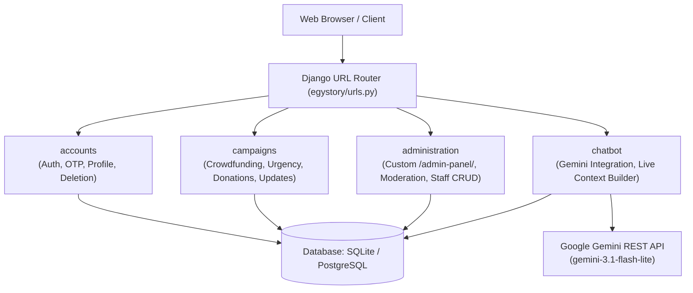

# EgyStory

## Overview

EgyStory is a full-featured Django web platform designed for community-driven crowdfunding in Egypt. The platform enables users to create, discover, fund, rate, and manage social, medical, emergency, and rare high-cost campaigns in Egyptian Pounds (EGP).

EgyStory includes a multi-factor campaign urgency scoring engine, owner campaign management tools, nested commenting, community reporting, an administrative moderation suite (`/admin-panel/`), and an in-app AI assistant powered by Google Gemini that answers platform and campaign queries using live database context.

---

## Key Features

### Authentication & User Management
- **Email-Based Authentication:** Uses email address as the unique login identifier rather than a username.
- **Egyptian Mobile Phone Validation:** Strict regex validation ensuring standard Egyptian mobile formats (`010`, `011`, `012`, `015`).
- **6-Digit OTP Email Activation:** New accounts are inactive by default; a 6-digit one-time token (valid for 24 hours) is sent via email for activation.
- **OTP Resend Flow:** Users can request a new verification code if their token expires or is unreceived.
- **Inactive Account Grace Period:** Re-registering with an unactivated email updates credentials and generates a fresh activation code without conflict.
- **Profile Management:** Users can view personal details, campaign history, and public donation records, as well as update their profile info and avatar. The email address is immutable once registered.
- **Password Reset:** Standard multi-step password reset workflow with dedicated HTML and text email templates.
- **Password-Protected Account Deletion:** Permanent account deletion requires explicit confirmation and verification of the user's current account password.

### Crowdfunding & Campaigns
- **Campaign Creation:** Supports campaign submission with title, category, multiple tags, detailed story, target goal amount in EGP, optional initial raised amount, deadline, primary cover image, and supporting verification documents.
- **Normal & Rare Case Types:** Rare and high-cost cases enforce mandatory deadlines and supporting documentation uploads.
- **Lifecycle & Statuses:** Full campaign lifecycle states: `Pending Review`, `Active`, `Completed`, `Expired`, and `Cancelled`.
- **Target & Progress Tracking:** Real-time calculation of total raised amount, remaining funds needed, and progress percentage.
- **Multi-Factor Urgency Scoring:** Automated formula (0 to 100) evaluating deadline proximity, percentage of goal remaining, and required daily funding velocity.
- **Critical Classification:** Campaigns reaching an urgency score of 70 or higher are automatically classified as Critical; administrators can also apply a manual Critical override.
- **Creator Cancellation Rule:** Campaign creators can cancel their campaigns only when the status is `Pending Review` or `Active`, and total funds raised are strictly less than 25% of the target goal.
- **Owner Story & Cover Image Management:** Dedicated management portal allowing creators to update their campaign story and change the primary cover image.
- **Campaign Milestone Updates:** Creators can publish, edit, and remove news updates and progress milestones for their campaigns.
- **Multi-Image Galleries:** Support for uploading multiple secondary gallery images during creation, with deletion capabilities for owners and staff.
- **Star Ratings:** 1 to 5 star rating system (one rating per user per campaign) with calculated average ratings and visual star breakdowns.
- **Nested Comments & Replies:** Multi-level comment and reply system. Users can delete their own comments or replies at any time.
- **Community Abuse Reporting:** Reporting mechanisms for campaigns (with categorized reasons and detailed descriptions) and individual comments.
- **Similar Campaigns Matcher:** Memory-optimized recommendation matching active campaigns by category and shared tag intersections.
- **Live Search & Autocomplete:** Search across titles, stories, and tags, complemented by a real-time JSON autocomplete suggestion endpoint (`/cases/autocomplete/`).
- **Filtering & Sorting:** Filter campaigns by status, category, tag, Rare cases, Critical cases, or Almost Funded (80% to 100% progress). Sort by newest, most urgent, almost funded, or recently completed.

### Donations
- **Internal Simulated Donations:** The donation system is an internal database-backed simulation.
- **No External Payment Gateway:** There is no integration with real payment processors (such as Stripe, Paymob, PayPal, or Fawry).
- **Automated Goal Completion:** Recording a simulated donation increments the campaign raised balance; reaching or exceeding the target goal automatically transitions the campaign status from `Active` to `Completed`.
- **Anonymous Donations:** Donors can toggle anonymous display to hide their identity from public donor listings and profile records.

### Administration & Moderation
- **Custom Admin Portal (`/admin-panel/`):** A custom administration interface separate from the default Django `/django-admin/`.
- **Role-Based Access Control:** Custom decorators enforcing staff access (`@admin_required`) and superuser-exclusive access (`@superuser_required`).
- **Dashboard Analytics:** Platform overview metrics tracking registered users, active campaigns, pending moderation items, completed goals, tags, and total simulated donations in EGP.
- **Campaign Moderation Queue:** Review pending campaign submissions with one-click actions to approve (set `Active`), reject, or cancel.
- **Featured & Critical Toggles:** Staff can mark campaigns as Featured; superusers can manually override Critical status.
- **Completed Campaign Management:** Allows safe, verified deletion of completed campaigns only.
- **User Management:** Non-staff user listing with cascade deletion capabilities (protected against self-deletion or deleting staff/superusers).
- **Admin Team Management (Superuser Only):** Superusers can create new staff accounts, edit admin details, toggle active status, forcefully reset admin passwords, or delete admin accounts.
- **Taxonomy & Tag Management:** Create, edit (with automated slug generation), and delete campaign tags.
- **Report Resolution:** Review submitted campaign abuse reports with actions to dismiss, mark reviewed, or cancel the offending campaign.
- **Comment Moderation:** Administrative listing of all platform comments and replies with one-click cascading deletion.

### AI Assistant
- **Provider & Model:** Powered by Google Gemini using the `gemini-3.1-flash-lite` model via direct REST integration.
- **Live Database Grounding:** Anti-hallucination context builder queries the live database for actual campaign data, platform rules, and recommendations based on user intent.
- **User-Specific Context:** If the user is logged in, the assistant safely retrieves a summary of their created campaigns and cancellation eligibility without exposing private credentials.
- **Session-Only Persistence:** Chat conversation history is held strictly in the active Django session (`request.session['chatbot_history']`) and is never written to the database.
- **Bilingual Capabilities:** Understands and responds in both Arabic and English based on user interaction.
- **Safe Error Handling:** Gracefully handles missing API configuration, network timeouts, and request limits (enforces a 1,000-character message ceiling).

### UI/UX
- **Design System:** Custom CSS token-based design system with clean card layouts, badge components, and interactive micro-animations.
- **Theme Support:** User-selectable Light and Dark theme toggle saved in `localStorage`. The custom Admin Panel strictly enforces Dark Mode.
- **Responsive Layout:** Responsive layout with mobile navigation drawer and desktop header navigation.
- **Hero Campaign Carousel:** Touch- and swipe-enabled carousel slider on the homepage with autoplay, pause-on-hover, and dot pagination.
- **Toast Notifications:** Animated global notification toasts with automatic timeout and manual dismissal.

---

## Architecture

EgyStory is organized into four core Django applications:



- **`accounts`:** User registration, Egyptian phone validation, OTP token email activation, session login/logout, profile management, password resets, and password-confirmed deletion.
- **`campaigns`:** Campaign lifecycle, multi-image handling, target calculations, urgency scoring, donation simulation, milestone updates, ratings, comments, reports, and handoff commands.
- **`administration`:** Custom `/admin-panel/` dashboards, moderation queue, user/staff management, tag taxonomy, report resolution, and comment moderation.
- **`chatbot`:** Session-based AI assistant interface, database context assembly, and Google Gemini API communication.

---

## Technology Stack

| Component | Technology | Description |
|---|---|---|
| **Language** | Python | Python 3.12+ / 3.14 |
| **Backend Framework** | Django | `>= 5.0` |
| **Development Database** | SQLite | `db.sqlite3` (Default local database) |
| **Production Database Driver** | `psycopg[binary]` | `>= 3.1.0` (PostgreSQL driver support) |
| **Configuration Management** | `python-decouple` | `>= 3.8` (Environment variable decoupling) |
| **Image Processing** | `Pillow` | `>= 10.0.0` (Avatar and campaign image validation) |
| **HTTP Client** | `requests` | `>= 2.31.0` (Google Gemini REST calls) |
| **AI / Large Language Model** | Google Gemini API | `gemini-3.1-flash-lite` |
| **Frontend Templates** | Django Template Language (DTL) | Server-rendered HTML5 templates |
| **Styling** | Vanilla CSS | Custom CSS token design system (No Tailwind, No Bootstrap) |
| **Frontend Scripting** | Vanilla JavaScript | ES6+, Fetch API, Touch/Swipe carousel, Toast system |

---

## Project Structure

```text
EgyStory/
├── manage.py
├── requirements.txt
├── .env.example
├── .gitignore
├── db.sqlite3                       # Local SQLite development database
├── fixtures/
│   └── dev_data.json                # Development seed dataset
├── egystory/                        # Project configuration
│   ├── settings.py
│   ├── urls.py
│   ├── views.py                     # Home page curation & slider view
│   └── wsgi.py
├── accounts/                        # User authentication & profiles
│   ├── models.py                    # User, ActivationToken
│   ├── forms.py                     # Registration, Login, Profile, Deletion
│   ├── views.py
│   ├── urls.py
│   ├── tests.py
│   └── management/commands/
│       └── create_admins.py         # Admin seed command
├── campaigns/                       # Crowdfunding engine
│   ├── models.py                    # Campaign, Category, Tag, Rating, Donation, Comment, Report
│   ├── forms.py
│   ├── views.py
│   ├── urls.py
│   ├── tests.py
│   └── management/commands/
│       ├── export_campaign.py       # Campaign & media packaging command
│       └── import_campaign.py       # Non-destructive campaign import command
├── administration/                  # Custom admin panel (/admin-panel/)
│   ├── views.py                     # Dashboard, Moderation, User/Staff/Tag/Report management
│   ├── forms.py
│   ├── decorators.py                # @admin_required, @superuser_required
│   ├── urls.py
│   └── tests.py
├── chatbot/                         # AI assistant app
│   ├── gemini_service.py            # Google Gemini REST client
│   ├── context_builder.py           # Live DB grounding queries
│   ├── views.py                     # Chatbot endpoints & session history
│   ├── urls.py
│   └── tests.py
├── templates/                       # Server-rendered HTML templates
│   ├── base.html
│   ├── home.html
│   ├── includes/                    # navbar, footer, messages, campaign_card, chatbot
│   ├── accounts/                    # register, login, profile, edit, verify_otp, password_reset
│   ├── campaigns/                   # case_list, case_detail, case_form, case_edit, donate
│   └── administration/              # dashboard, moderation, users, admins, tags, reports, comments
├── static/                          # Static assets
│   ├── css/                         # main, layout, components, home, admin, chatbot
│   ├── js/                          # main, admin, auth, chatbot
│   └── images/                      # SVG assets and logos
└── media/                           # User-uploaded files (avatars, campaigns, documents)
```

---

## Installation & Quick Start

### 1. Prerequisites
- Python 3.12+ (or 3.14)
- Git

### 2. Clone and Setup Environment
```bash
# Clone repository
git clone https://github.com/el-saadanyy/EgyStory.git
cd EgyStory

# Create virtual environment
python -m venv venv

# Activate virtual environment
# Windows (PowerShell):
.\venv\Scripts\Activate.ps1
# Windows (CMD):
venv\Scripts\activate.bat
# Linux / macOS:
source venv/bin/activate
```

### 3. Install Dependencies
```bash
pip install -r requirements.txt
```

### 4. Configure Environment Variables
Create a `.env` file in the project root based on `.env.example`:
```ini
SECRET_KEY=your-secret-key-here
DEBUG=True

# Google Gemini API Key (Required for AI Chatbot)
GEMINI_API_KEY=your-gemini-api-key

# Email SMTP Settings (For OTP activation & password resets)
EMAIL_HOST=smtp.gmail.com
EMAIL_PORT=587
EMAIL_HOST_USER=your-email@example.com
EMAIL_HOST_PASSWORD=your-email-app-password
EMAIL_USE_TLS=True
DEFAULT_FROM_EMAIL=noreply@egystory.com
```

### 5. Apply Migrations & Load Data
```bash
# Run database migrations
python manage.py migrate

# Load development dataset (Users, Campaigns, Tags, Donations, Ratings)
python -X utf8 manage.py loaddata fixtures/dev_data.json
```

### 6. Admin Account Creation (Optional)
```bash
# Create custom pre-configured development admins
python manage.py create_admins

# Or create a standard Django superuser
python manage.py createsuperuser
```

### 7. Run Development Server
```bash
python manage.py runserver
```
Navigate to `http://127.0.0.1:8000/` in your browser.

---

## Environment Variables

| Variable | Description | Example / Default (Placeholders) |
|---|---|---|
| `SECRET_KEY` | Django cryptographic secret key | `your-secret-key` |
| `DEBUG` | Django debug mode toggle | `True` / `False` |
| `DB_NAME` | PostgreSQL database name (if using Postgres) | `egystory` |
| `DB_USER` | PostgreSQL database username | `your-database-username` |
| `DB_PASSWORD` | PostgreSQL database password | `your-database-password` |
| `DB_HOST` | PostgreSQL host address | `localhost` |
| `DB_PORT` | PostgreSQL port | `5432` |
| `GEMINI_API_KEY` | Google Gemini API key for Chatbot Assistant | `your-gemini-api-key` |
| `EMAIL_HOST` | SMTP server host address | `smtp.gmail.com` |
| `EMAIL_PORT` | SMTP server port | `587` |
| `EMAIL_HOST_USER` | SMTP authentication email username | `your-email@example.com` |
| `EMAIL_HOST_PASSWORD` | SMTP authentication password / App password | `your-email-app-password` |
| `EMAIL_USE_TLS` | SMTP TLS encryption toggle | `True` |
| `DEFAULT_FROM_EMAIL` | Default sender email address | `noreply@egystory.com` |

---

## Database & Demo Data

- **SQLite Database (`db.sqlite3`):** The repository includes a populated SQLite database file tracked in version control for immediate demonstration and portfolio review.
- **Fixture Dataset (`fixtures/dev_data.json`):** A standalone JSON fixture containing categories, tags, demo users, sample campaigns across different lifecycle states, ratings, and donation records.
- **Note on Production:** The tracked SQLite database is intended for local demonstration. For production environments, configure PostgreSQL via the environment variables listed above.

---

## Campaign Handoff

EgyStory provides two custom Django management commands for exporting and importing campaigns between developer environments and automated agents:

### Exporting a Campaign
```bash
python manage.py export_campaign <CAMPAIGN_ID>
```
Packages the campaign data, owner identity metadata (natural keys), categories, tags, and all associated media files into a portable ZIP archive (`handoff/campaign_<ID>_handoff.zip`).

### Importing a Campaign
```bash
python manage.py import_campaign handoff/campaign_<ID>_handoff.zip
```
- **Non-Destructive:** Creates a brand-new Campaign record with a fresh primary key without overwriting existing data.
- **Natural Entity Resolution:** Matches users by email and tags/categories by slug or name.
- **Path-Traversal Secure:** Validates all archive entries to prevent extraction escapes outside `MEDIA_ROOT`.
- **Review Default:** Newly imported campaigns are placed in `Pending Review` status for administrative approval.

---

## Testing

The project includes an automated test suite covering authentication, campaign logic, administrative permissions, and the AI chatbot service.

```bash
# Run the entire test suite
python manage.py test
```

### Verified Test Scope
- **30 Total Test Classes** across the project:
  - `accounts/tests.py` (3 test classes): Registration flow, OTP validation, token expiration, profile field validation (birthdate/Facebook URL), password-confirmed deletion.
  - `campaigns/tests.py` & `campaigns/test_bug.py` (19 test classes): Multi-factor urgency calculations, donation balance triggers, category/tag assignments, multi-image galleries, star ratings, similar campaign matcher, creator cancellation rules (<25%), search autocomplete, nested comments, and owner story management.
  - `administration/tests.py` (7 test classes): Staff user management, superuser admin CRUD, moderation queue actions, manual Critical overrides, tag management, and completed campaign deletion.
  - `chatbot/tests.py` (1 test class): Context search grounding, recommendations, character length enforcement, session history persistence, and API error handling.

---

## Security Highlights

- **Decoupled Secrets:** Sensitive keys, database passwords, and SMTP credentials are read from `.env` via `python-decouple`.
- **CSRF Protection:** Django CSRF middleware is active across all standard forms and AJAX Fetch requests.
- **Password Security:** Password hashing using Django's default PBKDF2 implementation; account deletion requires active password re-verification.
- **OTP Account Verification:** Inactive accounts cannot log in until verified via a 6-digit email OTP.
- **Ownership Verification:** Server-side checks verify that only the campaign owner can edit the campaign story, publish milestone updates, or cancel eligible campaigns.
- **Role-Based Admin Protection:** Custom `@admin_required` (staff) and `@superuser_required` (superuser) view decorators protect all administration routes.
- **File Upload Restrictions:** Image uploads enforce size limits (<= 5MB) and MIME type checks.
- **Archive Extraction Security:** The campaign import tool validates ZIP paths against directory traversal sequences (`..`).

---

## Current Limitations

- **Simulated Donations:** The platform uses an internal database-backed donation model. Real payment gateway integrations (e.g., Stripe, Paymob, Fawry) are not implemented.

---

## Screenshots

<!-- Add homepage screenshot here -->
<!-- Add campaign details screenshot here -->
<!-- Add admin dashboard screenshot here -->
<!-- Add AI chatbot screenshot here -->

---

## License

No license has been specified for this project.
